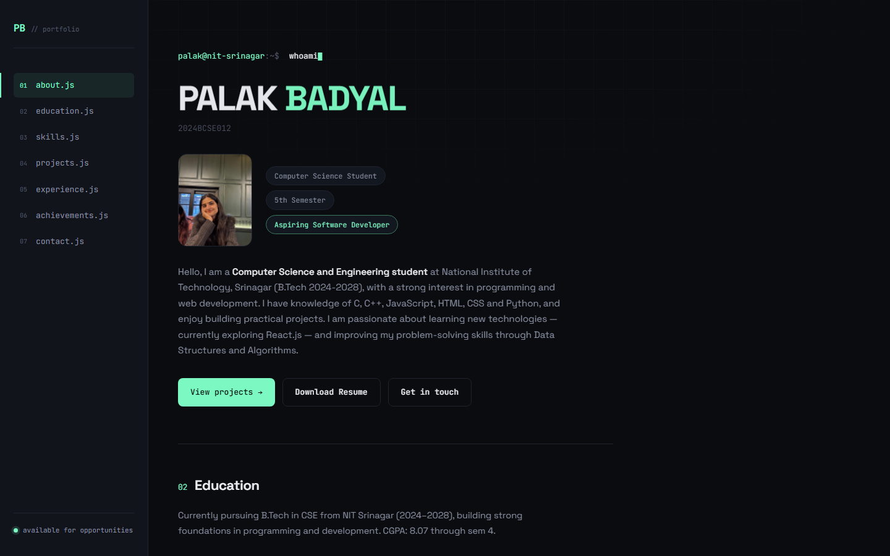

# Palak Badyal — Portfolio Website 🚀

Welcome to the official repository for my personal portfolio website! Designed with a **VS Code-inspired dark UI theme**, terminal-style hero section, custom file-tree sidebar navigation, and smooth scroll-reveal animations.



---

## ⚡ Tech Stack

- **Frontend**: HTML5, CSS3, Vanilla JavaScript (ES6+)
- **Typography**: Space Grotesk & JetBrains Mono
- **Styling**: Modern CSS Grid, Flexbox, Custom CSS Properties (`:root` variables)
- **Icons & Animation**: Custom CSS Keyframes & `IntersectionObserver` reveal animations
- **Performance**: Zero external JavaScript libraries, lightweight (< 5 KB JS bundle), lazy-loaded assets

---

## ✨ Features

- **VS Code Theme & File-Tree Navigation**: Interactive sidebar links styled like code editor tabs (`about.js`, `education.js`, `skills.js`, `projects.js`, `experience.js`, `achievements.js`, `contact.js`).
- **Terminal Hero Section**: Dynamic typing effect simulating terminal commands (`whoami`, `cat about.txt`, `node CashFlowAI.js`).
- **Featured Projects**: Showcase cards for **CashFlowAI** (AI-powered finance tracker), E-Commerce Frontend (Amazon clone), Tic Tac Toe, and Safar Saarthi platform.
- **Currently Building / Learning Panel**: Styled terminal status box tracking active learning (React.js, Python, Power BI, Azure).
- **Expandable Education Timeline**: Interactive accordion displaying semester-wise SGPAs (Sem 1: 7.95, Sem 2: 8.17, Sem 3: 7.92, Sem 4: 8.55) and CGPA card.
- **Experience & Stat Strip**: Highlights coordinator roles for Safar Saarthi (12 trips, 100+ participants, ~₹30L operations), Goexergy internship, and campus fests.
- **Fully Responsive & Accessible**: Custom hamburger drawer for mobile devices (360px+), keyboard support, and `:focus-visible` accessibility rings.

---

## 📂 Project Structure

```
portfolio/
├── index.html                  # Main HTML markup
├── index.css                   # Custom styles, variables, & responsive queries
├── script.js                   # Lightweight JS (< 5 KB) for typing & scroll reveal
├── palak_badyal_resume.pdf     # Resume document
├── profile.jpeg                # Profile picture
├── thumbnail.png               # Open Graph thumbnail
└── preview_1440.png            # Desktop preview screenshot
```

---

## 🚀 Local Development

1. **Clone the repository**:
   ```bash
   git clone https://github.com/palakbadyal69-wq/portfolio.git
   cd portfolio
   ```

2. **Open in browser**:
   Simply open `index.html` in your browser or use VS Code's **Live Server** extension.

---

## 📬 Contact & Connect

- **Email**: [palakbadyal69@gmail.com](mailto:palakbadyal69@gmail.com)
- **LinkedIn**: [Palak Badyal](https://www.linkedin.com/in/palak-badyal-947a18355)
- **GitHub**: [@palakbadyal69-wq](https://github.com/palakbadyal69-wq)
